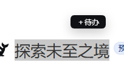
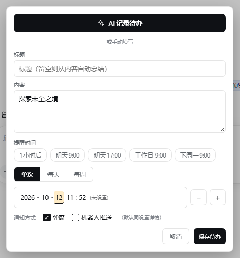
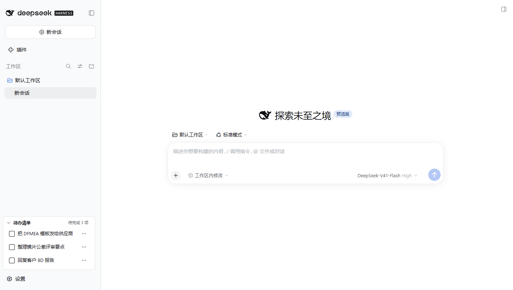

# dsh-todo-checklist ·「待办清单」

DeepSeek Harness（DSH）的待办插件：**把对话里冒出来的待办沉淀下来**。

> Todo sidecar plugin for DeepSeek Harness: capture todos straight from the conversation, review them in a left sidebar panel, and get due reminders via in-app popup or IM bot push. Data persists across restarts.

---

## 它能帮你做什么

- **划词加待办** —— 选中对话里的一句话，点「＋ 待办」，一句话变成一条待办
- **AI 记录待办** —— 把划词内容交给模型，自动拆成 标题 / 内容 / 提醒时间
- **对话自动记录** —— 说「记一下……」，模型调用内置工具 `todo_add` 写入
- **侧栏汇总** —— 左侧面板统一查看、搜索、筛选、勾选、分组
- **到期提醒** —— 到点弹**应用内提醒**，或推送到你的 **DSH-IM 机器人**
- **数据不丢** —— 重启 DSH 数据还在；单条数据损坏只影响该条，不影响整体

---

## 快速上手（3 步）

1. **安装**：左侧栏 → 插件 → 添加插件 → 填 `dsh-todo-checklist` → **完全退出并重启 DSH**
2. **加一条**：在任意对话里选中一句话 → 点「＋ 待办」→ 选「🤖 AI 记录待办」或手动填写
3. **看与处理**：点左侧图标列底部的「待办清单」展开；勾选完成、双击跳回原句、到期自动提醒

---

## 截图

### ① 划词气泡 —— 选中一句话，点「＋ 待办」

在任意对话里选中文字，出现「＋ 待办」气泡：



### ② 记录弹窗 —— 手动填写，或交给 AI 整理

点气泡打开记录弹窗：可手动填写标题 / 内容 / 提醒时间，也可点「🤖 AI 记录待办」把这段话交给模型自动整理（含分段式提醒时间输入，点哪段 ± 就加哪段）：



### ③ 左侧面板 —— 汇总、搜索、勾选、跳回原句

待办收纳在左侧图标列底部「待办清单」，展开即可查看与处理：



---

## 功能

| 功能 | 说明 |
|------|------|
| 划词加入待办 | 对话里选中文字 → 出现「＋ 待办」气泡 → 弹窗：**🤖 AI 记录待办**（把这段话交给模型整理成标题 / 内容 / 提醒时间，整理中面板显示「⏳ AI 整理中」）或手动填写 |
| 对话自动记录 | 对话里说「记一下……」模型可调用内置工具 `todo_add` 写入；`todo_list` 用于查询现有待办 |
| 左侧栏面板 | 挂在官方左侧图标列底部：收纳态显示「待办清单 · 预期 N 项 · 待完成 N 项」，展开为列表；含搜索、全部提醒筛选、未完成 / 已完成 / 已放弃 / 逾期 分组 |
| 到期提醒 | 每 30 秒扫描：到点弹**应用内提醒**（可「知道了 / 查看 / 完成」，查看会跳回划词所在会话并高亮原句），或经 **DSH-IM 机器人推送**（可全局设置，也可单条待办覆盖机器人 / 目标） |
| 待办处理 | 勾选完成；双击标题或点 ↗ 新建会话（自动带上来源会话的工作区与模型，发送后该待办自动完成）；行内图标：编辑 / 转 AI 总结 / 删除 |
| 编辑与延期 | 编辑标题、内容、提醒时间（**分段式输入：年 / 月 / 日 / 时 / 分，点哪段 ± 就加哪段**，分 ±30 分钟、时 ±1、日 ±1、月 ±1、年 ±1，自动进位）；延期三档：+1 天、下周一 09:00、自定义 |
| 转 AI 总结 | 把已有待办交给模型重新整理成结构化内容，并替换原条目 |
| 转定时任务 | 把待办转成周期性定时任务（**需已安装「定时任务」dsh-tasks 插件**，未安装时会给明确提示） |
| 持久保存 | 个人存储域 `dsh_todo_sidecar_items`，重启 DSH 不丢；单条数据损坏只影响该条，不会让整个插件不可用 |

---

## 环境要求

- DSH `>= 0.2.0-rc.1`（已测 `0.2.0-rc.1`、`0.2.0-rc.2`）
- Node.js `>= 22.18.0`
- 桌面端或 Web 端均可（客户端面声明 `platform: web`）
- **零运行时依赖**：宿主面已打包成自包含文件（`lib/host.js`、`lib/typert.js`，zod 已内联），安装时不需要下载任何依赖，离线 / 本地目录 / npm / tarball 四种装法都一致可用。

---

## 安装

**方式一：插件管理器（推荐）**
DSH 左侧栏 → **插件** → **添加插件** → 填入 `dsh-todo-checklist` → 安装完成后**完全退出并重启 DSH**。

**方式二：命令行**

```bash
dsh plugin --profile desktop add dsh-todo-checklist
```

**方式三：本地目录 / tarball**（未发布或内网环境）

```bash
dsh plugin --profile desktop add <本地目录或 tgz 的绝对路径>
```

升级到最新版：

```bash
dsh plugin --profile desktop add dsh-todo-checklist@latest
```

卸载：

```bash
dsh plugin --profile desktop remove dsh-todo-checklist
```

> 客户端界面部分的改动需要**重启 DSH** 才会生效。

安装成功的标志：打开任意会话，左侧图标列底部出现「待办清单」。

---

## 使用

- **加待办**：选中对话文字 → 点「＋ 待办」→ 选「🤖 AI 记录待办」让模型整理，或手动填标题 / 内容 / 提醒时间。
- **设提醒时间**：单次模式下，**点「年 / 月 / 日 / 时 / 分」任一段，再点 − / ＋ 按钮**，就在该段上步进（分 ±30、其余 ±1）；键盘 ↑ / ↓ 同样步进，← / → 切换段。
- **看与改**：点左侧「待办清单」展开；勾选完成；行内 ✎ 编辑、✦ 转 AI 总结、✕ 删除；⋯ 菜单为编辑 / 删除。
- **到点提醒**：默认弹应用内提醒；要在设置页勾选「DSH-IM 推送」后才会同时推送到机器人（需先装 dsh-im 并配置好机器人）。
- **新建会话**：双击待办标题，或点行内 ↗，会新建一个会话并把待办内容预填进输入框；新会话沿用**划词时那个会话的工作区与模型**，发送后该待办自动标记完成。

---

## 数据、隐私与权限

- **数据位置**：`<DSH_HOME>/storages/dsh_todo_sidecar_items.json`（默认 `<DSH_HOME>` 为 `~/.dsh`）。卸载插件不会删除该文件，需要清空可手动删除。
- **网络**：插件自身不发起任何外部网络请求；只有在你启用「DSH-IM 推送」时，才会通过本机 DSH-IM 服务把提醒发给你已配置的机器人。
- **日志**：默认不写任何日志文件。排障时设环境变量 `DSH_TODO_DEBUG=1`，日志写入 `<DSH_HOME>/dsh-todo/diag.jsonl`（可用 `DSH_TODO_STATE_DIR` 改目录）。
- **能力使用**：会话事件只读（用于到期提醒与自动完成）、按需创建会话（AI 记录 / 新建会话）、读取工作区列表、调用模型（AI 记录与 AI 总结）、调用 DSH-IM 发消息。

---

## 已知限制

- **提醒依赖 DSH 正在运行**：插件没有后台常驻进程，DSH 退出期间到点的提醒会在下次启动后补发。
- **机器人推送依赖 dsh-im**：未安装或未配置机器人时，推送不可用（应用内弹窗不受影响）。
- **转定时任务依赖 dsh-tasks**：未安装时无法转换，会给出提示。
- **AI 记录 / AI 总结会产生一次模型调用**（按你当前配置的模型计费）。
- 多个 DSH 实例同时运行时，同一条待办的机器人推送只会发出一次（跨进程原子认领）。

---

## 故障排查

- 打开 **F12 → Console**：
  - `__DSH_TODO_FOLLOWUP_TRACE__` —— 最近一次「新建会话」链路的逐步打点（工作区解析、RPC、打开会话）。
  - `__DSH_TODO_ENTRY_ERROR__` —— 界面槽位渲染异常记录。
- 提示「存储不可用」=待办数据文件无法解析，检查 `<DSH_HOME>/storages/dsh_todo_sidecar_items.json` 是否为合法 JSON。
- 提示「插件刚更新过：请重启 DSH 桌面端后重试」=宿主与界面的方法清单不一致，重启即可。
- 修改了「在左侧边栏显示待办清单」开关后，需要重启 DSH 生效。

---

## 开发

```
dsh-todo-checklist/
├── package.json          # dsh.bundle / dsh.client / dshhub 展示信息 / compatibility
├── cordis.patch.yml      # profile 配置层：插入 todo-sidecar 宿主插件
├── typert.js             # 宿主面 Typert 清单源码（strict codec，loader 自动发现）
├── host/
│   ├── index.js          # todos 服务、AI 记录、提醒引擎、todo_add / todo_list 工具
│   └── store.js          # 存储域与容错解析
├── client-src/index.js   # 客户端可读源码（手写 h()，无 JSX）
├── scripts/
│   ├── build-client.mjs  # esbuild → lib/client.js 工厂包
│   ├── build-host.mjs    # esbuild → lib/host.js、lib/typert.js（内联 zod，零依赖）
│   └── release-pack.mjs  # 打发布包：换名 + 重建产物 + 自检
└── lib/
    ├── client.js         # window.__ModuleLoader__.load({ id, factory }) 产物
    ├── host.js           # 宿主面入口（package.json 的 main）
    └── typert.js         # Typert 清单产物（exports["./typert"]）
```

- 构建全部产物：`node scripts/build-host.mjs && node scripts/build-client.mjs`（也可 `npm run build`）；模块 id 恒等于包名，与官方插件一致。
- 宿主面改动后必须重新 `build-host.mjs`——运行时读的是 `lib/host.js`，不是 `host/index.js`。
- `dependencies` 故意留空（zod 只在构建期需要，放在 `devDependencies`）：这样 `link:` 安装、离线安装都不会因为缺依赖导致插件激活失败。
- 打发布包（换名 + 重建产物 + 自检）：`node scripts/release-pack.mjs --name <npm包名>`。
- 变更记录见 [CHANGELOG.md](./CHANGELOG.md)。

---

## 许可

MIT
